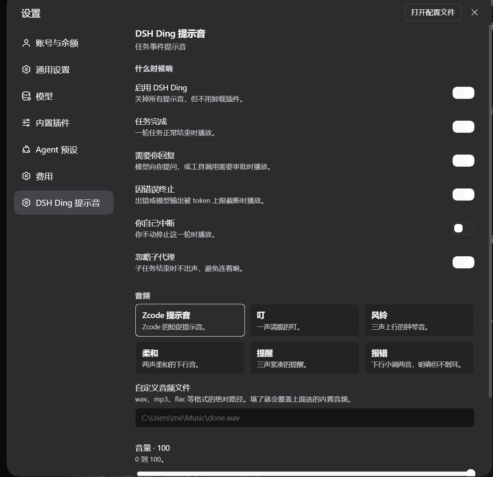

# dsh-ding-chime

[](https://www.npmjs.com/package/dsh-ding-chime)
[](https://github.com/Programmer-MrWang/dsh-ding/actions/workflows/ci.yml)
[](LICENSE)

Get a sound when DeepSeek Harness finishes a turn, needs your reply, or fails — so you can walk away from the screen.

[中文说明](README.zh.md)

<p align="center">
  
</p>

> **Note on the name.** The npm package is `dsh-ding-chime` because `dsh-ding` was
> already taken by an unrelated plugin. Install and search for `dsh-ding-chime`.

## Why a plugin and not a skill

A skill is an instruction sheet for the model: it only runs while the model is working and chooses to load it. All three moments you want a chime for are moments when the model is *not* running — the turn already ended, the agent is blocked waiting on you, or the run already died. A plugin subscribes to the Harness's authoritative events instead, so it does not depend on model behaviour or on the browser tab being focused.

## What it plays for

| Moment | Harness event |
|---|---|
| A turn finished | `session/event` → `turn/end` with `reason.kind === 'completed'` |
| The agent needs you | `user-questions/request` (questions and plan review), `approval/request` (tool approval) |
| A turn failed | `turn/end` with `error` / `max-tokens`, plus `agent/error` |

You can turn each of these off independently. Subagent turns are ignored by default, so delegating five tasks in parallel does not produce five chimes.

## Install

```bash
dsh plugin add dsh-ding-chime
```

Or from the Web UI: **Settings → Plugins → Discover**, then search for `dsh-ding-chime`.

## Settings page

The plugin adds a page to **Settings** (after Cost meter). Everything is editable there and saves straight into your profile's `cordis.patch.yml`, so it survives upgrades:

- **When to play** — four independent switches: turn finished, needs your reply, failed, and (off by default) you interrupted.
- **Ignore subagents** — on by default.
- **Chime** — pick one of six bundled sounds. Click a chime to hear it immediately.
- **Custom audio file** — an absolute path to any wav, mp3 or flac. Overrides the bundled chime. A missing file falls back to the chime instead of failing silently.
- **Volume** — 0–100.
- **Custom player command** — advanced escape hatch: `{file}` is replaced with the audio path, so you can point it at `mpv`, `afplay`, `aplay`, whatever you have.

### Bundled chimes

| Name | Character |
|---|---|
| **Zcode** | The short Zcode notification blip. |
| **Ding** | One crisp note. |
| **Chime** | Three rising bells. |
| **Soft** | Two gentle falling notes. |
| **Alert** | Three short urgent beeps. |
| **Error** | Falling minor two-tone. |

All six are original synthesis (`scripts/generate-sounds.py`, sine/triangle waves with an exponential decay envelope). No third-party samples, so the MIT license covers the whole package. Every file is 16-bit PCM mono WAV, which also means the Windows `SoundPlayer` fallback can always play them.

## How the settings page talks to the Host

The page is plain JavaScript served by the plugin itself, and it exchanges data over three same-origin routes the Host registers:

| Route | Purpose |
|---|---|
| `GET /dsh-ding/config` | current values plus whether the profile accepts writes |
| `POST /dsh-ding/config` | merge a patch into the stored configuration |
| `POST /dsh-ding/preview` | play a chime on the machine running the Harness |

Writes go through the Harness's own `configEditor`, so they land in your profile's `cordis.patch.yml` and survive restarts and upgrades. Preview plays on the Host rather than in the browser, which is why a chime still rings when the tab is in the background.

Routing the page this way keeps the browser half free of generated Remote bindings, so the plugin keeps working across Harness releases without codegen.

## How it plays audio

Nothing is bundled with a runtime to install, and nothing runs while idle:

1. **Your custom command**, if set.
2. **`ffplay`** — found on `PATH` or in common ffmpeg install locations. Handles every format and supports volume.
3. **Windows `SoundPlayer`** — the built-in fallback, works with the bundled WAVs alone.

Each chime spawns one short-lived player process and lets it exit. There is no daemon, no polling and no timer, so the plugin costs nothing between chimes. A playback failure is swallowed and never affects the turn.

There is a small deliberate delay: the first chime after boot takes ~1.4 s (the OS cost of starting a player); later ones are ~50 ms.

## Configuration file

The settings page writes this for you. If you prefer YAML, in your profile's `cordis.patch.yml`:

```yaml
- id: dsh-ding
  name: dsh-ding-chime
  config:
    enabled: true
    completed: true
    needsReply: true
    failed: true
    aborted: false
    topLevelOnly: true
    soundPreset: zcode      # zcode | ding | chime | soft | alert | error
    soundPath: ''           # absolute path; overrides soundPreset
    volume: 100
    command: ''             # advanced; {file} is replaced
```

## Requirements

- DeepSeek Harness with the Web UI.
- Node.js 20 or newer.
- Optional: ffmpeg (for formats other than 16-bit WAV, and for volume control). Without it, the bundled chimes still work through the Windows fallback.

## Development

```bash
npm test                 # 27 tests, no Harness needed
node scripts/build-client.mjs        # inline locale JSON into lib/client.js
node scripts/build-client.mjs --check # CI: fail if that block is stale
npm run gen:sounds       # regenerate assets/sounds from scratch
```

`lib/client.js` embeds its locale dictionaries because the browser artifact is a single self-contained module. `locale/*.json` stays the source of truth (Plugin Manager also reads `meta` from there), so edit the JSON and re-run the build script.

## License

MIT. See [LICENSE](LICENSE).
